<div align="center">

<!-- Custom Hero Banner (hosted directly in your repo) -->


<br />

<!-- Animated Tagline -->
<a href="https://github.com/Hrishi-git16">
  
</a>

<br />

<!-- Action & Social Pill Bar -->
<p>
  <a href="https://www.linkedin.com/in/hrishikesh-ithape-391545384/">
    
  </a>
  <a href="mailto:hrishikesh.ithape.os@gmail.com">
    
  </a>
  <a href="https://github.com/Hrishi-git16?tab=repositories">
    
  </a>
  <a href="https://github.com/Hrishi-git16">
    
  </a>
</p>

</div>

---

## ⚡ About Me

<table>
  <tr>
    <td width="52%" valign="top">
      <h3>👋 Hey, I'm Hrishi</h3>
      <p>
        I build end-to-end software where <strong>applied machine learning</strong>, <strong>security</strong>, and <strong>clean product engineering</strong> come together.
      </p>
      <ul>
        <li>🔬 Exploring <strong>Trustworthy AI</strong>, <strong>Computer Vision</strong> &amp; <strong>Federated Learning</strong></li>
        <li>🧩 Taking ideas from <strong>data pipelines</strong> to <strong>full-stack web apps</strong></li>
        <li>📊 Focused on turning noisy data into clear, reliable decisions</li>
        <li>🤝 Open to impactful <strong>AI, security &amp; full-stack</strong> collaborations</li>
      </ul>
    </td>
    <td width="48%" valign="top">

```python
class Hrishikesh:
    role = "AI/ML Engineer & Full-Stack Dev"
    focus = [
        "Trustworthy & Secure AI",
        "Fraud & Anomaly Detection",
        "End-to-End Web Products",
    ]
    stack = ["Python", "PyTorch", "TS", "React"]
    status = "Building & open to collaborate"
```

  </td>
  </tr>
</table>

---

## 🚀 Featured Work

<table>
  <tr>
    <td width="50%" valign="top">
      <h3>🛡️ Trust-Based Adaptive Productivity</h3>
      <p>An adaptive productivity system centered on trust-aware workflows and intelligent decision support.</p>
      <p>
        
        
      </p>
      <a href="https://github.com/Hrishi-git16/Trust-Based-Adaptive-Productivity-System">
        
      </a>
    </td>
    <td width="50%" valign="top">
      <h3>💳 Financial Fraud Detection Pipeline</h3>
      <p>End-to-end machine learning pipeline for preprocessing, modeling, and detecting anomalous financial transactions.</p>
      <p>
        
        
        
      </p>
      <a href="https://github.com/Hrishi-git16/End-to-End-Financial-Fraud-Detection-Pipeline">
        
      </a>
    </td>
  </tr>
  <tr>
    <td width="50%" valign="top">
      <h3>📊 Python Data Science Projects</h3>
      <p>Curated collection of applied data science experiments, exploratory analysis, and predictive modeling notebooks.</p>
      <p>
        
        
      </p>
      <a href="https://github.com/Hrishi-git16/Python-DataScience-Projects">
        
      </a>
    </td>
    <td width="50%" valign="top">
      <h3>🧪 Research &amp; Stealth Builds</h3>
      <p>Ongoing explorations in <em>Causal World Models</em>, <em>Secure Federated Learning</em>, <em>Traffic Vision</em> &amp; <em>PulmoScan AI</em>.</p>
      <p>
        
        
      </p>
      <a href="https://github.com/Hrishi-git16?tab=repositories">
        
      </a>
    </td>
  </tr>
</table>

---

## 🛠️ Tech Stack

<div align="center">

| Domain | Technologies |
| :---: | :--- |
| **AI, ML & Data** | [](https://skillicons.dev) |
| **Full-Stack & Web** | [](https://skillicons.dev) |
| **DevOps & Tools** | [](https://skillicons.dev) |

</div>

---

## 📈 GitHub Pulse

<div align="center">
  
  
</div>

<div align="center">
  
</div>

---

<div align="center">

### 🤝 Let's Build Something Meaningful

If you're working on **AI/ML, security, data systems, or full-stack products**, I'd love to connect.

<a href="https://www.linkedin.com/in/hrishikesh-ithape-391545384/">
  
</a>
<a href="mailto:hrishikesh.ithape.os@gmail.com">
  
</a>

<br /><br />


</div>
